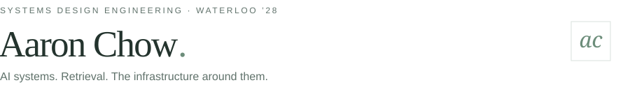

<picture>
  <source media="(max-width: 600px) and (prefers-color-scheme: dark)" srcset="assets/profile/heading-mobile-dark.svg">
  <source media="(max-width: 600px)" srcset="assets/profile/heading-mobile-light.svg">
  <source media="(prefers-color-scheme: dark)" srcset="assets/profile/heading-dark.svg">
  
</picture>

<a href="https://www.linkedin.com/in/aaron-sl-chow/">LinkedIn ↗</a> &nbsp; &nbsp; <a href="mailto:as3chow@uwaterloo.ca">Email ↗</a> &nbsp; &nbsp; <a href="https://devpost.com/aaron-sl-chow">Devpost ↗</a>

<h3>Selected projects</h3>

<strong>Sibyl</strong> &nbsp; 1st + Best AI/ML · Hack for Humanity Agent orchestration for sustainability-claim verification. <a href="https://devpost.com/software/sibyl-x8gpor">Overview ↗</a> &nbsp; <a href="https://www.youtube.com/watch?v=YWpDHMI29LM">Demo ↗</a> &nbsp; <a href="https://github.com/HackForHumanity2026/Sibyl">Code ↗</a>

<strong>Rosetta</strong> &nbsp; 3rd overall · HackHive Agentic RAG and live lecture translation. <a href="https://devpost.com/software/rosetta-hq6aby">Overview ↗</a> &nbsp; <a href="https://youtu.be/lfkztHWLoCs">Demo ↗</a> &nbsp; <a href="https://github.com/AbeerDas/Rosetta-HackHive">Code ↗</a>

<strong>Go-Phish</strong> AI phishing detection with clear explanations. <a href="https://devpost.com/software/go-phish-e7qzo3">Overview ↗</a> &nbsp; <a href="https://www.youtube.com/watch?v=6sejNYlVdSA">Demo ↗</a> &nbsp; <a href="https://github.com/achow111/Go-Phish">Code ↗</a>

<h3>Industry experience</h3>

<strong>8090 Solutions</strong> &nbsp; Software Factory · Current Agentic testing with my custom browser worker.

<strong>8090 Solutions</strong> Assay platform for 50+ Abbott scientists.

<strong>Fairfax Financial</strong> Hybrid RAG over financial filings and ISDA agreements.

<strong>Home Hardware</strong> Python API middleware for inventory workflows.

<strong>Tools I work with</strong> · Languages, AI & retrieval, backend, frontend

**Languages**

&nbsp;Python &nbsp; · &nbsp; &nbsp;TypeScript &nbsp; · &nbsp; &nbsp;SQL &nbsp; · &nbsp; &nbsp;Java &nbsp; · &nbsp; &nbsp;C++ &nbsp; · &nbsp; &nbsp;C#

**AI & retrieval**

&nbsp;LangGraph &nbsp; · &nbsp; &nbsp;LangChain &nbsp; · &nbsp; &nbsp;PyTorch &nbsp; · &nbsp; &nbsp;Hugging Face &nbsp; · &nbsp; &nbsp;pgvector &nbsp; · &nbsp; &nbsp;Qdrant &nbsp; · &nbsp; &nbsp;ChromaDB &nbsp; · &nbsp; &nbsp;Pinecone &nbsp; · &nbsp; &nbsp;Neo4j

**Backend & infrastructure**

&nbsp;FastAPI &nbsp; · &nbsp; &nbsp;Flask &nbsp; · &nbsp; &nbsp;PostgreSQL &nbsp; · &nbsp; &nbsp;MongoDB &nbsp; · &nbsp; &nbsp;Docker &nbsp; · &nbsp; &nbsp;AWS &nbsp; · &nbsp; &nbsp;Azure

**Frontend**

&nbsp;React &nbsp; · &nbsp; &nbsp;React Native &nbsp; · &nbsp; &nbsp;Next.js

